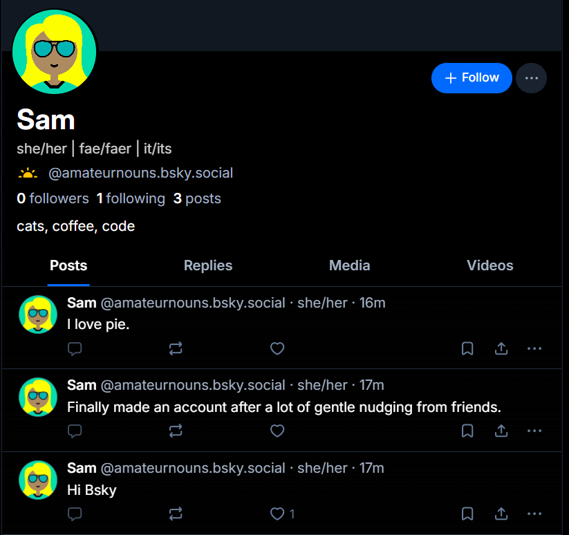
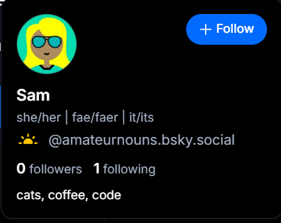
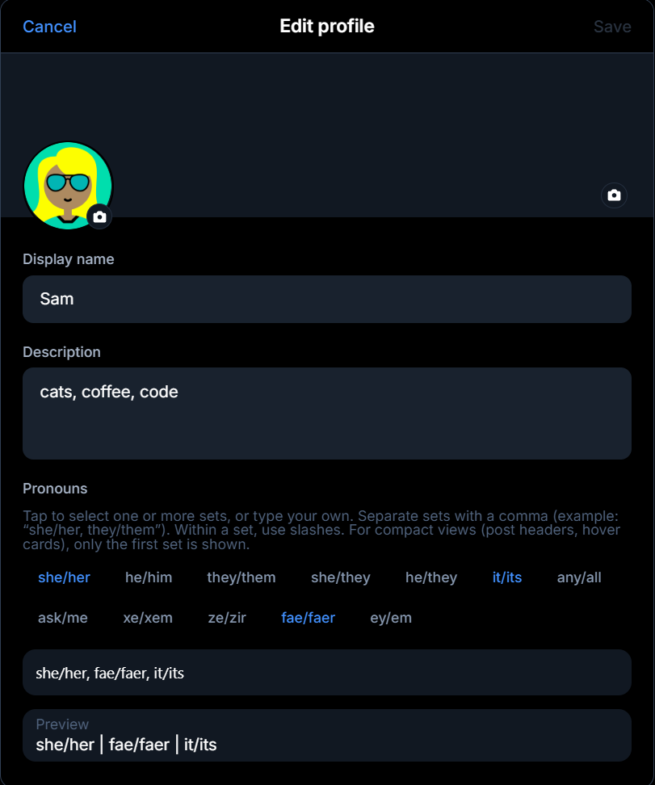

# ATProto Pronouns Lexicon

**Namespace:** `app.nearhorizon.actor.pronouns`
**Version:** 1.0
**License:** Apache 2.0

Pronouns as an ATProto record on the user's PDS. Not a labeler, not a freeform string, not someone else's service that can vanish.

## What it looks like

**Profile + feed:**



**Post detail:**


**Hover card:**



**Edit profile:**



## Why this exists

Bluesky added a `pronouns` field to the profile record — a single freeform string capped at 20 graphemes. Fine for "she/her", useless for multiple sets, neopronouns, or anything more complex.

A popular pronoun labeler got deleted and everyone's pronouns vanished with it. Labelers are someone else's server. When they go, your data goes.

This is a sidecar record on the user's PDS. Multiple ordered sets, open-ended forms per set, author-controlled display. What you type is what gets stored. Clients that don't understand the lexicon just ignore it.

## Quick start

### Reading someone's pronouns

No auth needed. Just fetch the record from their PDS:

```bash
curl https://bsky.social/xrpc/com.atproto.repo.getRecord\
?repo=did:plc:example\
&collection=app.nearhorizon.actor.pronouns\
&rkey=self
```

### Record structure

```json
{
  "$type": "app.nearhorizon.actor.pronouns",
  "sets": [
    { "forms": ["she", "her"] },
    { "forms": ["fae", "faer", "faerself"] },
    { "forms": ["star", "stars", "starself"] }
  ],
  "displayMode": "all",
  "createdAt": "2026-02-10T00:00:00Z"
}
```

Each set is a `forms` array — the pronoun forms as the user typed them. No predefined/custom distinction, all sets stored the same way. Display by joining with `/`.

Conventionally `forms[0]` is the subject form and `forms[1]` is the object form, but clients MUST NOT assume a fixed number of forms. Display by joining with `/`.

### Display modes

Two modes:

- **`all`** (default) — every set, joined with a separator: `she/her · fae/faer/faerself · star/stars/starself`
- **`firstOnly`** — just the primary set: `she/her`

If `displayMode` is absent or unrecognized, treat it as `"all"`.

### Writing pronouns

Standard `putRecord` call, authenticated as the user:

```typescript
await agent.com.atproto.repo.putRecord({
  repo: userDid,
  collection: 'app.nearhorizon.actor.pronouns',
  rkey: 'self',
  record: {
    $type: 'app.nearhorizon.actor.pronouns',
    sets: [
      { forms: ['she', 'her'] },
      { forms: ['they', 'them'] },
    ],
    displayMode: 'all',
    createdAt: new Date().toISOString(),
  },
})
```

To clear pronouns without deleting the record, write an empty `sets` array (preserving the original `createdAt`). To remove entirely, use `deleteRecord`.

### Editing pronouns

When updating an existing record, preserve the original `createdAt` and set `updatedAt`:

```typescript
// First, fetch the existing record to get the original createdAt
const existing = await agent.com.atproto.repo.getRecord({
  repo: userDid,
  collection: 'app.nearhorizon.actor.pronouns',
  rkey: 'self',
})

await agent.com.atproto.repo.putRecord({
  repo: userDid,
  collection: 'app.nearhorizon.actor.pronouns',
  rkey: 'self',
  record: {
    $type: 'app.nearhorizon.actor.pronouns',
    sets: [
      { forms: ['they', 'them'] },
    ],
    displayMode: 'all',
    createdAt: existing.data.value.createdAt, // preserve original
    updatedAt: new Date().toISOString(),       // set on every edit
  },
})
```

### What you need to adopt this

1. The lexicon definition ([`lexicons/app/nearhorizon/actor/pronouns.json`](lexicons/app/nearhorizon/actor/pronouns.json))
2. Join each set's `forms` array with `/` for display
3. Respect the author's `displayMode` field, defaulting to `"all"` when absent or unrecognized
4. Never normalize, reorder, merge, expand, or otherwise alter the user's forms during storage

## Specification

### Record key

`literal:self` — one per account, same pattern as `app.bsky.actor.profile`.

### Sets

Each entry in `sets` is a `pronounSet` object containing a single `forms` array. Forms are stored exactly as the user provided them. The first entry in `sets` is the user's primary pronoun set. Maximum 10 sets. Each set may contain up to 12 forms, each form up to 24 graphemes.

### Normative rules

**No normalization:** Clients MUST NOT normalize, reorder, merge, expand, or otherwise alter the user's pronoun forms during storage. What people type in should show up as they typed them.

**`displayMode` default:** If `displayMode` is absent from the record **or contains an unrecognized value**, clients MUST treat it as `"all"`. Always implement this fallback explicitly — this ensures old clients continue working when new display modes are added.

**Empty sets:** `sets` may legally be an empty array. If empty, clients SHOULD render nothing. This allows users to clear their pronouns without deleting the record (preserving `createdAt` and the record's existence). When clearing, clients MUST preserve the original `createdAt` and set `updatedAt` — do not construct a fresh record with a new `createdAt`.

**Timestamps:** `createdAt` is set once on initial creation and MUST NOT change on subsequent edits. `updatedAt` is set on every edit after initial creation and is absent on first write. When editing, clients MUST preserve the original `createdAt` and set `updatedAt` to the current time.

### Rendering

**Display a set:** Join `forms` with `/`. That's it. `["she", "her"]` → `she/her`. `["fae", "faer", "faerself"]` → `fae/faer/faerself`.

**Display all sets:** Join rendered sets with a separator. Recommended: ` · ` (space-middot-space) or ` | ` depending on context.

**Inline on posts:** Pronouns appear after the handle, before the timestamp. Muted color, slightly smaller weight than the handle. If the viewer has disabled pronoun display or the author has no record, nothing renders — no placeholder, no layout shift.

**Profile header / hover card:** Below the display name. Larger than inline, still secondary to the name.

### Catalog

A catalog of common pronoun sets (common, neo, therian, system/plural) is available for picker UIs — but it never touches records. Clients can ship whatever catalog they want, extend it, or skip it. Users can always type custom forms regardless.

## Adopting this

Any ATProto client can implement it. If you do, open an issue or PR to get listed here.

## License

Apache 2.0

### Implementations

*None yet — be the first!*