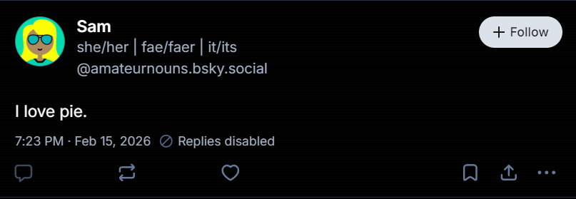

# Displaying pronouns

## Rendering a set

Join the set's `forms` with `/`. Nothing else.

- `["she", "her"]` → `she/her`
- `["fae", "faer", "faerself"]` → `fae/faer/faerself`
- `["she", "they · it", "faer"]` → `she/they · it/faer`

## Display modes

- **`all`** (the default): every set, in order, joined with a separator.
  Recommended separators are ` · ` (space, middot, space) or ` | `, depending
  on context: `she/her · fae/faer/faerself · star/stars/starself`.
- **`firstOnly`**: only the first set: `she/her`.

If `displayMode` is absent or unrecognized, use `all`.

## Which source to show

Work through these in order and stop at the first that applies:

1. **The pronouns record hasn't loaded yet, or the fetch failed.** Show
   nothing. Don't show the Bluesky profile's field in the meantime, or a cached
   value you can't confirm is current. Showing something and then swapping it
   produces a flash of pronouns the user may have removed.
2. **The record exists and `sets` is empty.** Show nothing. The user cleared
   their pronouns on purpose. Don't fall back to the Bluesky profile's field.
3. **The record exists and has sets.** Show them, following `displayMode`.
4. **There is no record.** You may fall back to the Bluesky profile's
   `pronouns` field (`app.bsky.actor.profile`), or show nothing.

When nothing is shown, render no placeholder and leave no gap, so the layout
doesn't shift.

## Placement

- **Inline on posts:** after the handle and before the timestamp. Muted
  colour, slightly lighter than the handle. If the viewer has turned pronoun
  display off, show nothing.
- **Profile header and hover card:** below the display name. Larger than
  inline, still secondary to the name.

## Catalogs

A picker UI can offer a catalog of common sets (for example common, neo,
therian, system/plural). A catalog is a client convenience and never touches
records: what is stored is whatever the user ends up with. Clients can ship
any catalog, extend it, or skip it, and users can always type their own forms.

## Screenshots

| Profile and feed | Post detail |
| --- | --- |
|  |  |

| Hover card | Edit profile |
| --- | --- |
|  |  |
